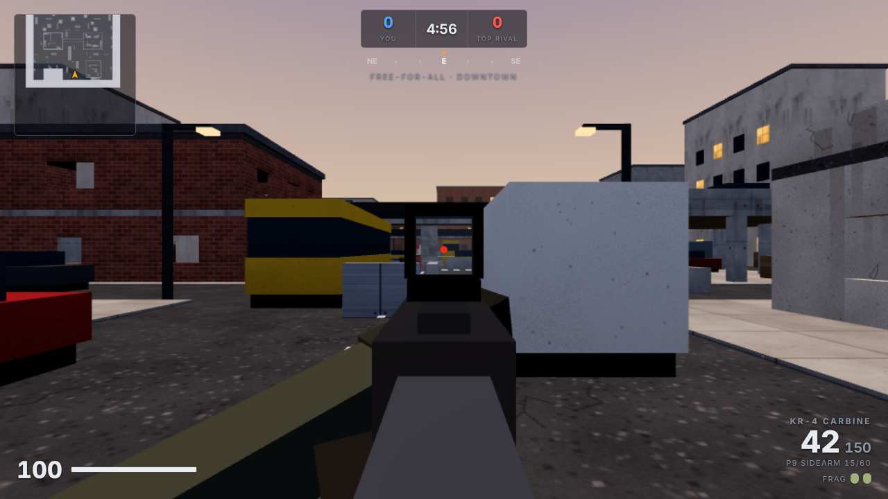
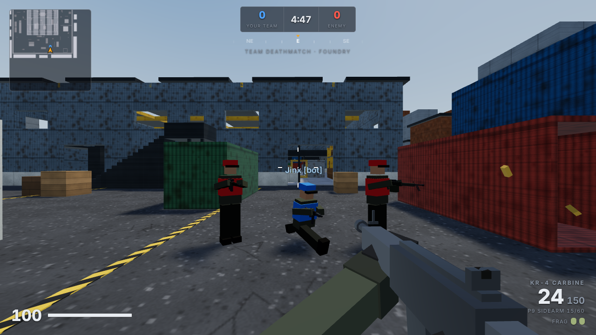
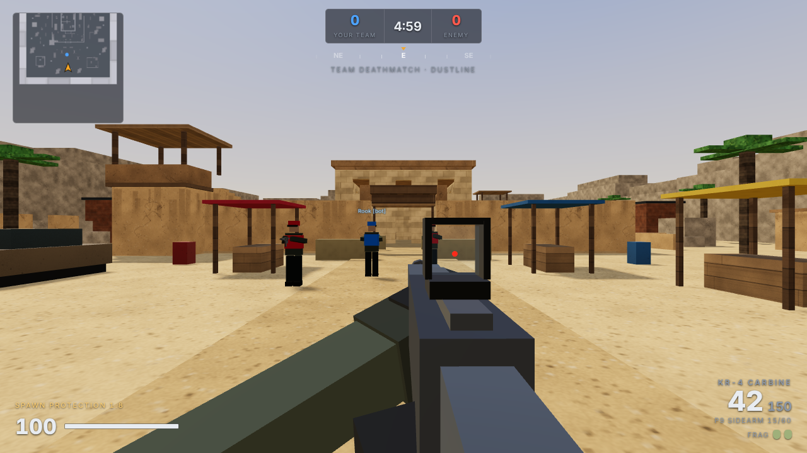

# Breachline

A browser-based multiplayer first-person shooter. Static HTML + JavaScript (Three.js), peer-to-peer
networking with a 5-letter room code, no build step, no server required, no asset files — every
model, texture and sound is generated in code.

| | | |
|---|---|---|
|  |  |  |

- **Modes:** Team Deathmatch, Free-for-All, Gun Game (fixed ladder, final kill must be a knife kill)
- **Maps:** Downtown (urban streets), Foundry (industrial warehouse), Dustline (desert compound)
- **Weapons:** 8 primaries (2 assault rifles, 2 SMGs, shotgun, marksman rifle, LMG, sniper), 2 pistols, knife, frag grenade
- **Progression:** 30 player levels, 12 mastery levels per gun, 11 attachments in 5 slots, saved in
  `localStorage` with an export/import code
- **Netcode:** host-authoritative simulation with lag-compensated hit detection, client-side
  prediction + reconciliation, snapshot interpolation
- **Bots:** optional, so you can test alone

> Read [What is rough or missing](#what-is-rough-or-missing) before you plan a game night. It is
> an honest list.

---

## Run it locally

You only need a static file server (ES modules do not load from `file://`).

```bash
npm start
```

Then open <http://localhost:8080>. (`npm start` runs `node tools/serve.mjs`; it has no
dependencies, so `npm install` is not needed just to play. Any other static server works too, e.g.
`python3 -m http.server 8080`.)

**Play alone:** Play → Create room → pick a number of bots → Start match.

**Two players on one computer:** open the game in two tabs. On the Play screen set *Connection* to
"This browser only" in both tabs (or add `?net=local` to the URL), host in one tab and join with
the code in the other. Both tabs share one saved profile because they share the browser's storage.

## Host and join a match with friends

1. Everyone opens the same URL (your GitHub Pages or Cloudflare Pages address).
2. One player: **Play → Create room**. A 5-letter room code appears in the lobby. Share the code,
   or click **Copy invite link** and send that (`…/?join=ABCDE`).
3. Friends: **Play → Join**, type the code (the invite link fills it in for them).
4. The host picks mode, map, score limit, time limit and bots, then **Start match**. In Team
   Deathmatch players can switch teams in the lobby.
5. Players who arrive late can join a match that is already running with the same code.

The host's browser runs the match. If the host closes the tab or leaves, the room ends for
everyone. The host can alt-tab without freezing the match (the simulation runs on a background
timer), but their own player stands still while they are away.

Up to 12 players per room (bots count). Hosting works best from the player with the best
connection and a reasonably fast machine.

## Controls

All keys can be rebound in **Settings**. Mouse sensitivity, ADS sensitivity, field of view,
invert-Y, toggle crouch/aim, graphics quality and volume are there too.

| Action | Default |
|---|---|
| Move | `W` `A` `S` `D` |
| Look | Mouse (Pointer Lock, raw input where the browser supports it) |
| Jump | `Space` |
| Sprint | `Left Shift` (hold, while moving forward) |
| Crouch | `C` (hold) |
| Slide | Press crouch while sprinting |
| Fire | Left mouse |
| Aim down sights | Right mouse (hold) |
| Reload | `R` |
| Quick melee | `V` — a hit from behind is an instant kill |
| Frag grenade | `G` — hold to cook (arc preview shown), release to throw |
| Primary / secondary | `1` / `2`, swap with `Q` or the mouse wheel |
| Scoreboard | `Tab` (hold) |
| Pause menu | `Esc` (also releases the mouse) |

Crouch is on `C` rather than `Ctrl` because browsers reserve `Ctrl+W` (close tab) and a web page
cannot block it.

---

## Deploy to GitHub Pages

The repository is the site. There is nothing to build.

```bash
git remote add origin https://github.com/<you>/<repo>.git
```

```bash
git push -u origin main
```

Then on GitHub: **Settings → Pages → Build and deployment → Source: "Deploy from a branch"**,
branch `main`, folder `/ (root)`. After a minute the game is at
`https://<you>.github.io/<repo>/`.

All paths in the project are relative, so it works from a sub-path like `/<repo>/` without
changes. `.nojekyll` is included so GitHub serves the files as-is. GitHub Pages serves over HTTPS,
which WebRTC and Pointer Lock need.

## Move to Cloudflare Pages

**Step 1 — the site (no code changes).** In the Cloudflare dashboard: **Workers & Pages → Create →
Pages → Connect to Git**, pick the repository, and set:

- Framework preset: *None*
- Build command: *(empty)*
- Build output directory: `/`

Deploy. The game works exactly as on GitHub Pages, still peer-to-peer through PeerJS.

**Step 2 (optional) — replace PeerJS with a Cloudflare relay.** Do this if some of your friends
cannot connect to each other directly (strict NAT, campus or office firewalls). A Worker with one
Durable Object per room relays the traffic over WebSockets. The hosting player's browser is still
the game authority; nothing else changes.

```bash
cd server/cloudflare
```

```bash
npx wrangler deploy
```

Wrangler prints the Worker URL, e.g. `https://breachline-relay.<your-subdomain>.workers.dev`.
Put it in [`src/config.js`](src/config.js), using `wss://`:

```js
backend: params.get('net') || 'cloudflare',
// ...
cloudflare: { url: params.get('relay') || 'wss://breachline-relay.<your-subdomain>.workers.dev' },
```

Commit and push; Cloudflare Pages redeploys. To try the relay before making it the default, leave
`backend` on `'peerjs'` and open the game with
`?net=cloudflare&relay=wss://breachline-relay.<your-subdomain>.workers.dev`.

Notes on the relay:

- Uncomment `ALLOWED_ORIGIN` in [`server/cloudflare/wrangler.toml`](server/cloudflare/wrangler.toml)
  to accept connections from your site only.
- It uses SQLite-backed Durable Objects, which the Workers free plan allows. A relay room receives
  roughly 30 messages per second per player while a match runs, and Cloudflare bills incoming
  WebSocket messages against the Workers request allowance at a discounted ratio. Expect a few
  hours of play per day on the free plan for a full room; check Cloudflare's current pricing.
- With a relay, latency is host → Cloudflare → player instead of direct, usually a little higher
  than a good peer-to-peer link.

**Going further.** [`src/game/sim.js`](src/game/sim.js) (the authoritative simulation) has no
browser dependencies. It could run inside the Durable Object instead of the host's browser, which
would make the server the authority and remove the host's advantage. That step is not done here;
the relay is a transport swap only.

### How the swap is structured

The game talks to the network through two small interfaces defined in
[`src/net/transport.js`](src/net/transport.js):

```
HostTransport:   start(code)  send(peerId, obj, reliable)  close()   onPeer / onPeerLeft / onMessage
ClientTransport: connect(code)  send(obj, reliable)  close()         onMessage / onClose
```

| Backend | File | What it is |
|---|---|---|
| `peerjs` (default) | `src/net/transports/peerjs.js` | WebRTC data channels; PeerJS broker only for the handshake |
| `cloudflare` | `src/net/transports/websocket.js` + `server/cloudflare/worker.js` | WebSocket relay through a Durable Object |
| `local` | `src/net/transports/local.js` | BroadcastChannel between tabs of one browser, for testing |

PeerJS uses the free public PeerJS cloud broker by default. To use your own broker set
`peerjs.host/port/path` in `src/config.js` (or `?peerhost=…&peerport=…`). To add a TURN server,
set `peerjs.iceServers`.

---

## How it works

### Netcode

- **Fixed 60 Hz simulation.** `src/game/player.js` contains one deterministic function,
  `stepPlayer(state, command, world)`, covering movement and weapon handling. The client and the
  host run the same function.
- **Prediction.** The client applies each input immediately and sends it to the host (30 packets
  per second, each repeating the last few inputs so a lost packet costs nothing).
- **Authority.** The host replays every input, decides all hits, damage, grenades, kills, scores
  and XP, and sends 30 snapshots per second. A client cannot move faster than real time: inputs
  beyond the allowance are dropped.
- **Reconciliation.** Each snapshot carries the host's state for your player plus the last input
  it processed. The client rewinds to that state and replays the inputs still in flight. Because
  both sides run identical code, this normally changes nothing; when it does (the host moved you),
  the camera eases to the corrected position.
- **Interpolation.** Other players are drawn 100 ms in the past, interpolated between snapshots.
- **Lag compensation.** When you fire, the host rewinds other players to where they were on your
  screen (up to 350 ms) before testing the shot. Spread is seeded per shot, so the bullet holes
  you see are the shots the host evaluated.
- **Host's own player** goes through the same client code over an in-memory link, so there is a
  single code path.
- **Disconnects.** Closing the tab sends a goodbye; otherwise the host drops a player after 10 s
  of silence, and a client gives up on a silent host after 12 s. Clients ping every second, which
  also drives the ping column on the scoreboard.

Test the feel under latency with `?lag=120&jitter=20&loss=2` on a joining tab.

### Project layout

```
index.html              page shell (import map for Three.js, PeerJS script)
css/style.css           menus + HUD
vendor/                 three.module.min.js, peerjs.min.js (+ their licences)
src/
  main.js               app flow: menus <-> lobby <-> match
  config.js             network backend, PeerJS / relay settings, test switches
  gameclient.js         in-match client: input -> commands, camera, effects, HUD
  game/                 shared rules, no DOM and no Three.js (runs in Node too)
    weapons.js          weapon + attachment data, Gun Game ladder, stat math
    player.js           deterministic movement + weapon step
    world.js            box collision world, raycasts
    grenade.js          grenade physics (also used for the arc preview)
    sim.js              host-authoritative match simulation
    bots.js             practice bots (grid A* navigation)
    modes.js            mode definitions and lobby options
    progression.js      XP tables and unlock rules
    maps/               builder toolkit + downtown / foundry / dustline
  net/
    transport.js        transport interfaces, factory, loopback, latency simulator
    transports/         peerjs.js, websocket.js (Cloudflare), local.js
    host.js             lobby + match lifecycle on the host
    client.js           prediction, reconciliation, interpolation
    protocol.js         message reference
  core/                 input, settings, profile (save/export/import), audio synth, ticker
  render/               renderer, world mesh, textures, view model, soldiers, effects
  ui/                   menu screens, HUD
server/cloudflare/      relay Worker + Durable Object, wrangler.toml
tools/                  dev server, map validator, test suites
```

### Game reference

**Movement.** Walk 5.0 m/s, sprint 7.4 m/s, crouch 2.6 m/s (scaled by weapon weight). Sprint +
crouch starts a slide with a speed boost that decays; 1.1 s slide cooldown. No sprinting while
aiming; each gun has its own sprint-to-fire delay. Sprint adds a field-of-view kick; head bob can
be turned off.

**Weapons.**

| Gun | Class | Unlock | Damage | RPM | Mag | Reload | Notes |
|---|---|---|---|---|---|---|---|
| KR-4 Carbine | Assault rifle | 1 | 28 → 18 | 720 | 30 | 2.2 s | balanced |
| Hornet-9 | SMG | 1 | 22 → 12 | 900 | 32 | 1.8 s | fast, short range |
| P9 Sidearm | Pistol | 1 | 26 → 16 | 420 | 15 | 1.5 s | |
| Breacher-12 | Shotgun | 4 | 8 × 17 | 72 | 6 | 2.9 s | pump action |
| DMR-14 Ranger | Marksman | 7 | 52 → 42 | 300 | 15 | 2.4 s | semi-auto, 2× sight |
| Magnus .50 | Pistol | 9 | 55 → 33 | 170 | 7 | 1.9 s | |
| Bulldog MG | LMG | 10 | 32 → 23 | 620 | 75 | 4.6 s | slow handling |
| Longbow .338 | Sniper | 13 | 105 | 46 | 5 | 3.2 s | bolt action, 5× scope |
| Vulkan-47 | Assault rifle | 16 | 36 → 24 | 560 | 30 | 2.5 s | heavy recoil |
| Wasp-45 | SMG | 20 | 27 → 15 | 780 | 25 | 1.9 s | |

100 health, regenerating after 5 s without damage. Headshots multiply damage by 1.2–2.0 depending
on the gun; leg shots do slightly less. Knife: 60 damage, instant kill from behind. Frag: 3.5 s
fuse, 7.5 m radius, two per life. Three seconds of spawn protection, cancelled by attacking.

**Attachments** (one per slot; each has an upside and a cost, shown in the Loadout screen):
Red Dot, 2.5× Combat Scope · Suppressor, Long Barrel, Compensator · Extended Mag, Speed Mag ·
Foregrip, Laser Sight · Skeleton Stock, Padded Stock. Each mastery level from 2 to 12 unlocks one.

**Progression** (Team Deathmatch and Free-for-All only). Kill 100 XP, headshot +25, longshot +25,
assist 40, first blood +50, revenge +25, kill streaks, back stab +50, match completion up to 250,
victory up to 250, top three in FFA 100. Max level needs 60,900 XP: about 4.5 hours at a typical
2,300 XP per ten-minute match. Max mastery on one gun needs 12,650 weapon XP: about 1.3 hours of
kills with that gun. The Career screen has the export/import code.

**Gun Game.** Ladder: P9 → Hornet-9 → KR-4 → Breacher-12 → Vulkan-47 → Wasp-45 → DMR-14 →
Bulldog → Magnus → Longbow → Knife. Every kill moves you up one gun; a quick-melee kill also
knocks the victim down a tier. The match is won by a knife kill on the last tier. Loadouts,
attachments, grenades and XP are all disabled; the host ignores whatever loadout a client sends.

---

## Tests

```bash
npm test
```

runs the Node suites (no browser needed):

| Suite | What it checks |
|---|---|
| `tools/test-rules.mjs` | 150 checks: movement speeds, slide and cooldown, sprint-to-fire delay, every gun's fire rate / magazine / reload / falloff, attachments, headshots, back stab, lag compensation, friendly fire, spawn protection, speed-hack protection, each mode's win condition, Gun Game ladder and its loadout/XP isolation, progression pacing |
| `tools/test-sim.mjs` | full bot matches in every mode on every map; no invalid state, nobody falls through the floor, matches finish |
| `tools/test-net.mjs` | host + remote client with simulated latency, jitter and loss: zero mispredictions, exact convergence, host-side hits |
| `tools/validate-maps.mjs` | every spawn is in free space and on the ground; flood fill with the real movement code proves all spawns are mutually reachable and there are no places you can enter but not leave |

The end-to-end browser test drives two real browser tabs (join by code, movement, combat, grenade,
late join, post-match, host leaving). It needs Playwright and the dev server running:

```bash
npm install && npm install --no-save playwright && npx playwright install chromium
```

```bash
npm run test:browser
```

Add `-- --net=peerjs --peerhost=127.0.0.1` (with `npm run peer-server` running) to run it over
real WebRTC, or `-- --net=cloudflare --relay=ws://127.0.0.1:8787` (with `npx wrangler dev` running
in `server/cloudflare`) to run it through the relay.

## What is rough or missing

**Not verified in this build**

- **Frame rate on real hardware.** Development happened in a container with no GPU, so the "60 fps
  on a mid-range laptop" target is unmeasured. What was measured: 15–22k triangles and roughly 100
  draw calls per frame with 8 players on Medium, and under 1 ms of game-logic CPU per frame. Those
  numbers are small, but the proof is running it. If it is slow, drop to Low (no shadows, simpler
  materials, 75 % resolution).
- **The public PeerJS broker and real internet play.** The two-tab test passed over real WebRTC
  using a local PeerJS server, and through the Cloudflare relay running locally under
  `wrangler dev`. It has not been run against `0.peerjs.com`, across two home networks, or
  against a deployed Worker.
- **Browsers other than Chromium.** Only Chromium was exercised. Firefox and Safari are expected
  to work but are untested.
- **Balance and pacing.** Weapon stats, bot difficulty and the XP curve come from arithmetic and
  bot matches, not from people playing.

**Limits of the peer-to-peer design**

- The host has zero latency and everyone else has their ping to the host. If the host leaves, the
  match ends; there is no host migration.
- Hit detection, movement, scores and XP awards are decided by the host, so ordinary players
  cannot cheat those. The host could, because the host's browser is the server. Progression lives
  in each player's own `localStorage`, so a player can edit their own level or unlocks; the host
  only checks that a loadout is a legal combination, not that it was earned.
- Direct WebRTC fails on some networks (symmetric NAT, strict firewalls). PeerJS's free TURN
  fallback is best-effort. The Cloudflare relay is the fix.
- "Unreliable" traffic uses unordered WebRTC channels, which still retransmit. Good enough at
  50–150 ms; a lossy link will feel worse than a true UDP game.

**Game features that are thin or absent**

- No objective mode, so "objective XP" is covered by bonuses (first blood, streaks, revenge,
  completion, placement).
- Grenades you throw are spawned by the host, so they appear one round trip late. The arc preview
  is exact.
- No kill cam, text or voice chat, spectator mode, controller support or touch controls.
- No mantling or ladders; height comes from stairs, and a jump clears about one metre. Players can
  walk along the tops of walls and railings they manage to reach.
- Bots are simple: ground floor only, no grenades, no use of stairs.
- Anti-aliasing changes need a page reload.

**Presentation**

- Everything is procedural: box-built maps and soldiers, canvas-painted textures, synthesised
  sound. It is clean and readable, not AAA art. Soldiers have a walk cycle, crouch and death
  poses, but no skeletal animation. Reload and melee are view-model motions rather than authored
  animations.
- Interiors are lit by ambient and sky light only (no placed lights), so rooms look flatter than
  the outdoors.

## Credits and licences

See [CREDITS.md](CREDITS.md). In short: Three.js (MIT) and PeerJS (MIT) are the only third-party
code, both vendored. There are no third-party models, textures, fonts or sounds.
